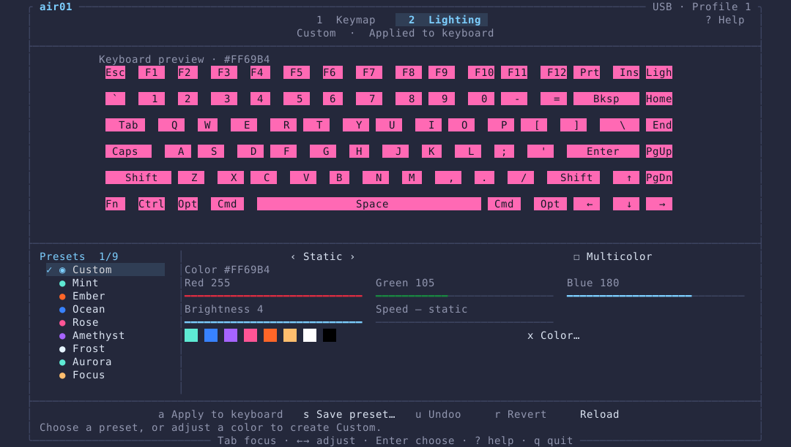

# air01

A native Rust CLI and terminal interface for configuring the **Akko Air 01 on
Linux**. Inspect profiles, remap keys including Fn, save or restore keymaps, and configure RGB lighting with reusable presets.
No browser, cloud account, WebKit, root GUI, or kernel module.

Tested hardware: wired USB `3151:5002`, device ID **3013**, firmware `1.10`.
Other device IDs and ambiguous protocol replies are rejected; firmware versions
are not allowlisted. This is an early, independent project, not an
Akko product. There is no firmware flashing or factory-reset command.

## Why settings can appear to disappear

The keyboard has four normal profiles. A mapping saved in profile 0 does not
change profile 2. On the test board, profiles 0 and 3 contained a Ctrl/Fn swap
while active profile 2 still had the defaults. `air01 profiles` shows all four.
This explains that observation; it does not establish every possible cause of
settings loss.

## Install

With Rust 1.88 or newer:

```sh
cargo install --locked --path .
air01 info
```

NixOS:

```sh
nix build
./result/bin/air01 info
nix profile install .
```

The Nix package builds with a pinned nixpkgs input and Cargo.lock. The Linux
HID backend does not require libudev development libraries. The flake also
provides a development shell: `nix develop`.

### Device permissions

If your existing VIA/Akko rule already permits HID access, do not add another.
Otherwise, on NixOS add this to a system module and rebuild, then replug:

```nix
services.udev.extraRules = ''
  SUBSYSTEM=="hidraw", ATTRS{idVendor}=="3151", ATTRS{idProduct}=="5002", MODE="0660", TAG+="uaccess"
'';
```

Other distributions can install `udev/70-air01.rules` and reload udev. The rule
grants access to the active local session; do not run the application as root.
Close other keyboard configurators before using air01. The process lock only
coordinates other air01 instances, not browsers or unrelated applications.

## CLI

Connect a USB **data** cable and select wired mode. Writes over the receiver or
Bluetooth are not supported in this release. Changes stored on the board can
then be used wirelessly.

```sh
air01 devices
air01 info
air01 profiles
air01 --profile 2 keymap
air01 --profile 2 keymap --layer fn-win

air01 backup my-keymaps.json
air01 --dry-run swap-fn-ctrl --all-profiles
air01 swap-fn-ctrl --all-profiles

air01 --profile 2 remap 5 LeftCtrl
air01 --profile 2 remap 11 Fn
air01 --profile 2 remap 42 Escape --layer fn-win

air01 profile 0
air01 --dry-run restore my-keymaps.json
air01 restore my-keymaps.json
air01 restore my-keymaps.json --activate
```

Slots are hardware matrix positions, not visual row/column numbers. On the
verified Air 01, **5 is physical Fn and 11 is physical left Ctrl**. The swap
preset sets slot 5 to LeftCtrl and 11 to Fn, regardless of their current state.
It defaults to the active profile; `--all-profiles` makes the assignment
consistent across all four. It skips already-correct entries, including both
observed encodings of LeftCtrl. Keep another Fn assigned before replacing one.

Actions accept a key name (`A`, `F1`, `LeftCtrl`, `Escape`), `Fn`, `Disabled`, or
an exact four-byte value such as `raw:00:00:e0:00`. Raw entries are for people
who know the device format. Unknown entries are preserved in snapshots.

`--dry-run` prints the plan without configuration writes. It is not accepted
with the interactive TUI. A dry-run backup only prints its destination.
`--allow-no-fn` explicitly permits a CLI keymap transaction with no Fn key;
normal operations refuse that result.

A normal restore preserves the currently active profile. Add `--activate` to
select the snapshot's saved active profile after restoring its maps. If that
final selection fails, the error explicitly distinguishes it from the already
restored maps.

## Backups and recovery

Mutating CLI/TUI operations automatically save a private, mode-0600 backup in
`$XDG_STATE_HOME/air01/backups`, or `~/.local/state/air01/backups`. The CLI reports the backup path; failures include its recovery location. Explicit backup destinations are never overwritten.

Snapshots cover **four base keymaps and eight Windows/Mac Fn maps**, plus the
active profile and device identity. They do **not** include macros, RGB,
per-key paint, sleep timers or other device settings. Restoring is therefore
limited to those keymaps and optional profile selection.

Writes are paced and read back. A failed or mismatched write triggers an
attempt to restore the affected entries. Errors distinguish verified recovery
from **INCOMPLETE** recovery and name the affected slots. If recovery cannot be
verified, close the application, reconnect the cable, inspect the profile, and
restore the printed backup. No write is blindly retried.

The transport returns an error after three seconds without a worker reply and
refuses further commands. Linux HID feature ioctls cannot be cancelled through
hidapi, so a timed-out write has an unknown outcome; air01 does not claim it was
rolled back. Reconnect before continuing. Do not run another configurator
against a timed-out device while this process is still exiting.

## Terminal interface

```sh
air01 tui
```

The TUI draws the real **84-key Air 01**, with staggered rows, wide modifiers,
spacebar and arrow keys. It fits 80×24 and centers a bounded keyboard
inside a workspace up to 112×36, leaving space around it on larger terminals.
A terminal-native background, one shared frame, section separators and a single
focused-control highlight keep both workspaces consistent. Flat, spaced keycaps
avoid overlapping box borders; the contextual footer keeps shortcuts discoverable. Remapped keys are amber. Initial USB reading takes
about 12 seconds, with a progress screen while profiles and lighting are read.

- **Click a key** to open its searchable assignment picker. Type to filter,
  use arrows or the mouse, and press Enter/click an assignment to preview it.
  F2 opens advanced raw assignment input; Esc cancels. The base layer offers
  Disabled; Fn layers offer Inherit base, because a zero Fn entry falls through
  to the base assignment.
- **Arrow keys** move spatially around the keyboard. Enter / `e` opens the
  selected key's picker. Hidden matrix gaps are never navigation targets.
- Click **profile tabs**, or use PgUp/PgDn / `[` / `]`, to preview profiles.
  Only **Activate / `a`** changes the board's active profile.
- Click **Base / Win Fn / Mac Fn**, or use Tab, to inspect layers. Empty Fn
  entries display the inherited base assignment rather than a disabled key.
- **`s`** previews the Ctrl/Fn preset for the viewed profile; **`b`** saves a
  fresh backup; **`r`** requests an absolute snapshot path to restore.
- Changes show an **Apply / Cancel** dialog, followed by the same fresh backup
  and verified transaction as the CLI. Click Apply or press `y` to commit.
- **`q`** quits from the keyboard view. Ctrl+C exits from every mode. Mouse
  capture is disabled and terminal state restored on exit.

Use the slot-oriented CLI for advanced inspection of storage positions that
have no physical key. Below 80×24, the TUI asks for a larger terminal and does
not start edits.

### Lighting studio



Press **2** or click **Lighting**; **1** returns to Keymap. **? / F1** opens
Help. The lighting workspace controls the **active hardware profile**, independent
of the profile previewed in Keymap. Its keyboard shows the selected solid RGB color;
multicolor animations use neutral keycaps and an explicit label because their
per-key color arrangement is controlled by firmware.

- **Custom** is always available. Editing a color, effect, brightness or speed
  selects Custom and keeps that draft when you try another preset. Modified
  values never retain a misleading built-in preset name.
- Click a preset, or use ↑↓ and Enter in the library. Eight built-ins include
  Mint, Ember, Ocean, Rose, Amethyst, Frost, Aurora and Focus.
- Click/drag RGB, brightness and speed bars. Click swatches for quick colors;
  **x Hex color** accepts `#RRGGBB` (Ctrl+U clears the input).
- Use the effect arrows and Multicolor toggle. Static ignores animation speed;
  Spectrum always uses changing colors. Selecting a custom color exits Spectrum.
- Tab / Shift+Tab follows visual control order and skips unavailable actions
  (including animation speed for Static); ←→ adjusts values and
  Enter activates the focused control. Presets and edits only change the draft.
- **a Apply to keyboard** saves an exact lighting backup, writes once and verifies readback.
  **u Undo** restores the previous applied setup, with the same verification.
  **r Revert** discards draft edits. **Reload** refreshes the active profile;
  revert a changed draft first.
- **m Animate…** opens the text animation dialog (the same feature as
  `air01 lighting marquee`). Type the text, pick the style (one letter at a time
  or a continuous banner), direction, step speed and per-letter pause; a live
  preview plays the frames and shows the frame count and upload time. It uses
  the draft's color and brightness. **Enter** saves a lighting backup, uploads
  the frames (about 20 s for CLAUDE) and selects mode 25; **u Undo** returns to
  the previous lighting. Settings are kept while the TUI is open.
- **s Save** names a reusable custom preset; it saves the draft without applying
  it. Names allow 1–32 ASCII letters, digits, hyphens and underscores. Existing
  names are never overwritten. Saved presets appear in the library on restart.

Lighting CLI equivalents:

```sh
air01 lighting show
air01 lighting presets
air01 --dry-run lighting preset Aurora
air01 lighting preset Mint
air01 lighting set --color '#8B5CF6' --effect 2 --brightness 3 --speed 2
air01 lighting set --rainbow --effect 4
air01 lighting save my-desk
air01 lighting preset my-desk
air01 lighting restore /absolute/path/to/lighting-backup.json
```

### Onboard text animation

`air01 lighting marquee` stores a per-key animation on the keyboard (light mode
25) and plays it from the board's own memory, like the built-in effects. Nothing
keeps running on the PC, and it keeps playing wirelessly once uploaded.

```sh
air01 lighting marquee --preview | less      # print every frame, no USB access
air01 --dry-run lighting marquee             # CLAUDE in orange #FF5500
air01 lighting marquee                       # one big letter at a time, left → right
air01 lighting marquee CLAUDE --style scroll --direction left --delay-ms 90
air01 lighting marquee HELLO --color '#5EEAD4' --hold-ms 400 --brightness 3
```

Letters use a bold 5×5 font on the function row through the bottom letter row.
The default `letters` style slides each letter in from the left, pauses it in the
middle (`--hold-ms`) and slides it out to the right; `scroll` moves the whole
text as one banner. The board holds at most 255 frames. The upload saves the
previous lighting as a backup and prints its `lighting restore` command. Frames
cannot be read back, so only the mode selection is verified; check the result by
eye.

Brightness and speed range from 0 to 4. Effect IDs are listed in the [protocol notes](docs/PROTOCOL.md). Lighting backups are private
versioned JSON in `~/.local/state/air01/lighting-backups`, saved presets in
`~/.local/state/air01/themes` (or the equivalent under `$XDG_STATE_HOME`). They
are separate from keymap snapshots. Restore requires the backup's profile to
be active; it never silently switches profiles. Global RGB/effects and the onboard text animation are supported;
per-key painting, host-fed screen/music sync and side lighting are not included.

## Validation and development

```sh
cargo fmt --check
cargo clippy --locked --all-targets -- -D warnings
cargo test --locked
cargo run --example inspect    # read-only, requires the supported board
```

Tests cover packet layouts, identity/protocol gating, malformed snapshots,
Fn-preserving ordering, stale plans, no-op flash avoidance, send/read-back
failures, recovery failures, backup permissions, CLI dry-run behavior and TUI
navigation. Hardware checks confirmed all four base profiles after the swap,
with only the requested slots changed and Fn maps unchanged. Physical key
behavior and persistence across a power cycle must be verified by the person
using the keyboard; a successful USB read-back alone does not prove them.

Firmware `1.10` has been exercised for normal-profile remaps. Fn-map write
shapes are based on the cited Gen2 firmware/protocol research and tested with a
simulated device, but have not yet been exercised on this Air 01. Restore is
verified per slot; a crash or power loss mid-restore is not atomic. The original
snapshot remains available for recovery.

See [protocol notes](docs/PROTOCOL.md) and [attribution](NOTICE). Licensed under
[GPL-3.0-or-later](LICENSE). No repository has been published by this setup.

UI layout references: [Yazi](https://github.com/sxyazi/yazi) and
[Lazygit](https://github.com/jesseduffield/lazygit). The app uses a shared shell,
section separators, one focus indicator and contextual shortcuts. No launcher,
compositor or terminal-window settings are changed by the UI.
